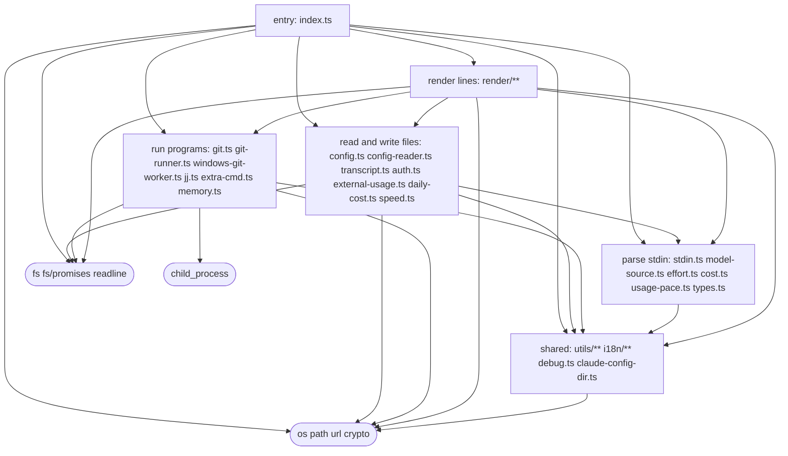

# Architecture

This diagram is a test. `verify/arch.check.mjs` reads it on every pull request and compares it with
the runtime imports in `src/` (type-only imports don't count, because they vanish at runtime). It fails if:

- a file is in no box, or in two;
- an import crosses from one box to another with no arrow for it;
- an arrow is drawn that no import uses.

Square boxes list the files they own. Rounded nodes are Node builtins, so an arrow into one is
permission to touch the world that way: `proc` runs programs, `fsio` reads and writes files.

## What a render does today

1. `entry` reads Claude Code's stdin payload (`logic`) and the config (`files`).
2. It gathers only what the enabled elements need, in parallel: the transcript, git or jj, the extra
   command, memory, auth, the usage snapshot, the cost ledger and speed state (`files` and `run`).
3. `render` turns that into lines, and `entry` prints them.

## Where the lines are crossed today

The diagram shows the code as it is, not as it should be. Three arrows break the rule that
rendering does no I/O. They are the work the cage (spec step 3) removes:

- `render --> fsio`: `render/vcs.ts` calls `fs.statSync` to sort changed files newest first.
- `render --> run`: `render/lines.ts` imports `formatBytes` from `memory.ts`, which imports `child_process`.
  Under a load allow list, `render` would fail to load.
- `render --> files`: `render/parts.ts`, `vcs.ts`, `compact.ts` and `expanded.ts` import config
  defaults from `config.ts`, and `parts.ts` imports `formatAuthSegment` from `auth.ts`, so loading
  `render` loads `fs`.

Once those are gone, nothing that `render` or `logic` loads can reach `fsio` or `proc`.
