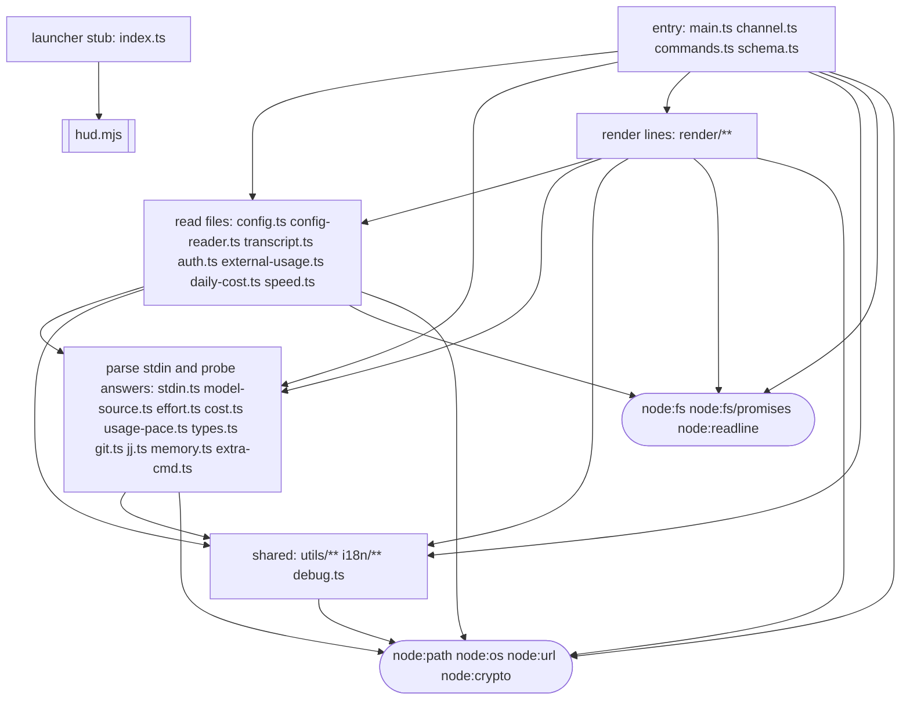

# Architecture

Agents own the logic. The owner owns the capabilities. The runtime enforces the line, twice: on
GitHub's machines, where the maintainer agent works, and on every user's machine, where the HUD runs.
A capability is anything that touches the world: running a program, writing a file outside one
folder, the network, a key, posting, merging. Everything else is logic.

```
                 MAINTAINER (a fresh GitHub VM)                    USER (after each Claude Code message)
 LOGIC     ┌─ agent job: Claude as unix user `agent` ────┐    ┌─ src/**/*.ts, caged ───────────────────────┐
 (agent)   │ reads inbox.json, writes outbox + patches   │    │ parse stdin, ask for probes, render lines, │
           │ no keys; network = the loopback relay only  │    │ the /hud subcommands; writes data/ only    │
═══════════╪════════ files only ════ THE LINE ═══════════╪════╪═════ JSON lines on fd 0 and 1 ════════════╪═══
 CAPABILITY│ harness.mjs + relay: holds the token,       │    │ hud.mjs: runCage, terminalFilter           │
 (owner)   │   per-run and daily token caps              │    │ collector.mjs: every path, every program   │
           │ act.mjs: reply | label | close | propose,   │    │   but Node (git, jj, vm_stat, extra cmd)   │
           │   and the `gate` check                      │    │ fence.mjs + node --permission: the cage    │
           │                                             │    │ install.mjs: writes the statusLine setting │
           │                                             │    │ launcher + stubs: run the newest install   │
           │                                             │    │ skills/hud: Claude runs 4 read-only verbs  │
           │                                             │    │   without asking; the rest prompt          │
           └─ ruleset: one required check, `gate` ───────┘    └────────────────────────────────────────────┘
      verify/ (on GitHub, every PR) judges both sides, and `gate` reads it; ci.yml's tests are advisory
      a merge that moves the version = a release; users get it on their next plugin update
```

In the repo, the line is the `AGENT` list at the top of `maintainer/act.mjs`, the one place it is
written. It names the agent's side: logic, its tests and the prose. Releases, changes that only move
the version in the manifests, are the agent's too. Everything else is the owner's, so any kind of
plugin file Claude Code learns to run later is the owner's from the start. `gate` passes an
owner-owned change only when the owner wrote it or approved its exact head. Each agent run records
what it spent in its artifact's name, `relay-tokens-<n>`, which the next run reads for the daily cap
and the scorecard reads for cost.

On the user's side, one render is:

```
Claude Code ─stdin─▶ hud.mjs ─▶ collector.mjs: paths (logicPaths), data/, probes, and stripped/:
                        │       src/ with types removed by Node's own stripper, read-only to logic
                        └─▶ runCage: node --permission --allow-fs-read=<each path, stripped/> --allow-fs-write=data/
                                     --import=fence.mjs src/main.ts
                              ─▶ {stdin, now, paths}  ◀─ ask: ["git.status", …] ─▶ answers  ◀─ {lines, snapshot?}
           terminal ◀─ terminalFilter: colour, and links to file: or the session's own GitHub repo
```

A test case (`tests/corpus/*.json`) is the same render with the probes' answers recorded as `facts`,
so the corpus replays git and jj states without running either. Every check in `verify/` goes
through the same `runCage`. The owner's own walls (the terminal filter, git's untrusted config,
program lookup on Windows) are pinned by fixed data in `verify/owner.check.mjs`, not by tests the
agent can edit.

## The logic side, as a test

This diagram is a test. `verify/arch.check.mjs` reads it on every pull request and compares it with
the runtime imports in `src/` (type-only imports vanish when Node strips the types). It fails if a
file is in no box or in two, if an import crosses boxes with no arrow for it, if an arrow is drawn
that no import uses, or if the rounded nodes are not exactly the builtins `fence.mjs` lets logic
load. Square boxes own the files they list. A rounded node is a set of Node builtins, so an arrow
into one is permission to touch the world that way. `hud.mjs` is the owner's code, drawn because the stub
every launcher imports under Bun forwards to it; inside the cage it can't load at all, since it needs
`node:child_process`.



`fsio` is bounded by `--permission`: logic reads only the paths `collector.mjs` names in `paths`
and writes only `data/`. Nothing in `src/` can reach `node:child_process`, `node:net` or any other
builtin: `fence.mjs` refuses the import, and this test refuses the diagram.
